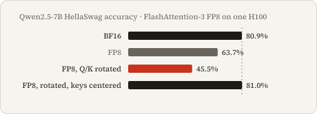
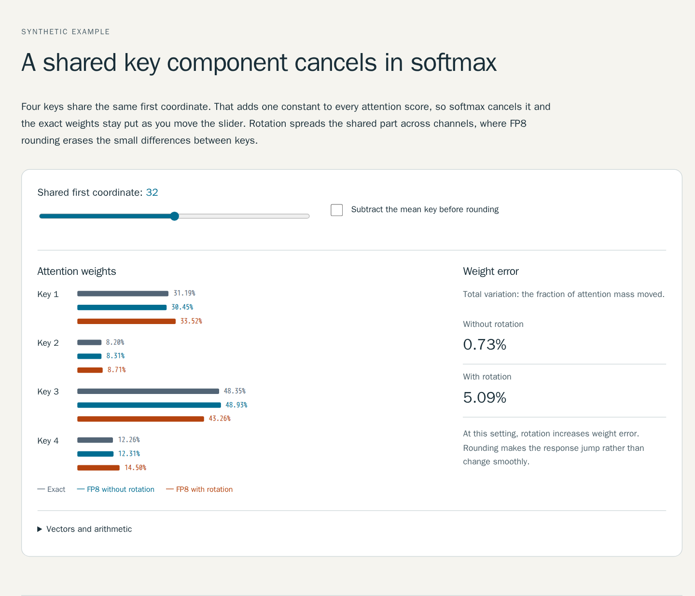
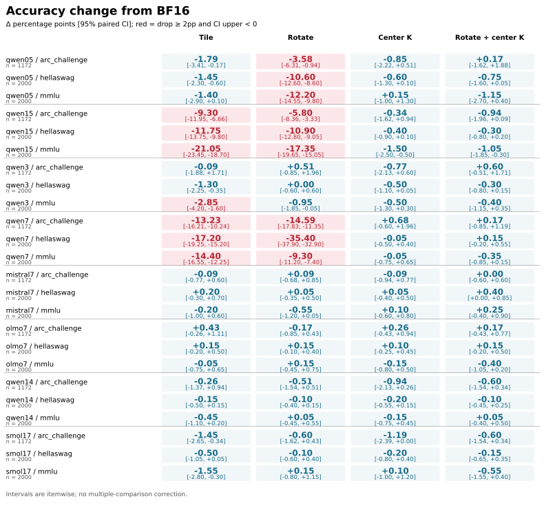

# temperament

On an H100, batch scoring Qwen2.5-7B-Instruct with FlashAttention-3's FP8 attention (scales and key means taken over the full sequence) drops HellaSwag accuracy from 81% to 64%, and subtracting the mean key before quantizing brings it back to 81% without changing exact attention. Because the statistics include later tokens, the result is for batch scoring rather than streaming generation.

<picture><source media="(prefers-color-scheme: dark)" srcset="docs/hero-dark.svg"></picture>

Each run scores ARC-Challenge, HellaSwag and MMLU zero-shot with only the attention changed, so projections, RoPE, norms and MLPs stay in BF16. The table gives Qwen2.5-7B-Instruct's accuracy in percent:

| Attention | ARC-Challenge | HellaSwag | MMLU |
|---|---:|---:|---:|
| BF16 | 55.20 | 80.90 | 71.60 |
| Plain FP8 | 41.98 | 63.70 | 57.20 |
| FP8 + rotation | 40.61 | 45.50 | 62.30 |
| FP8 + centered keys | 55.89 | 80.85 | 71.55 |
| FP8 + centered keys + rotation | 55.38 | 81.05 | 71.25 |

The rotation is a Hadamard transform of Q and K, which is FA3's own recipe for FP8, and on this model it does worse than plain FP8 on two of the three tasks.

## What the mean key does

Keys in these models share a large component across tokens. Subtracting one vector from every key moves all of a query's scores by the same amount, and softmax ignores a constant shift, so exact attention is unchanged. The FP8 scale, though, has to cover the whole key tensor, shared offset included, which leaves few grid points for the small differences between keys that decide where attention goes. With the offset gone, the scale fits those differences instead. Rotation spreads the offset across every channel, so every channel loses resolution.

Centering keys is SageAttention's smooth-K and rotation is FA3's, so neither trick is mine, and what this repo adds is a measurement of both on the real FA3 kernel.

[](https://mottopanikeiku.github.io/temperament/)

On the [explainer page](https://mottopanikeiku.github.io/temperament/) you drag the shared offset and watch rotation turn it into rounding error. It also plots 2,880 attention heads from an earlier CPU emulation study of six small models.

## Eight checkpoints

Plain FP8 hurts two of the eight checkpoints badly (Qwen2.5-1.5B and 7B, up to 21 points) and keeps the other six within 3 points. Rotation helps some model and task pairs and hurts others, and it is the only variant that damages Qwen2.5-0.5B. With centered keys, rotated or not, every checkpoint stays within 1.5 points of BF16 on every task.



Red marks a drop of at least 2 points whose paired 95% interval stays below zero. HellaSwag and MMLU are fixed 2,000-item samples, and the Qwens are instruction-tuned while the other families are base models.

## Rebuild the report

The report rebuilds on a CPU from the saved per-item answers:

```sh
uv sync --locked --python 3.13
uv run python -m study.accuracy.report \
  --additional-plan data/accuracy/qwen14-plan.json \
  --additional-plan data/accuracy/smol17-plan.json
```

The tests run on a CPU without downloading any models:

```sh
uv sync --locked --extra capture --python 3.13
OPENBLAS_NUM_THREADS=1 OMP_NUM_THREADS=1 uv run pytest -q
node --test site/test.mjs
```

Re-scoring needs an H100 80GB on Modal, and the first six-model run cost under $5. The GPU commands, the statistics and the CPU emulator are described in [docs/METHODS.md](docs/METHODS.md).

Qwen2.5-3B is under the noncommercial Qwen research license and the other checkpoints are Apache-2.0. This repo redistributes none of the weights, and its code is MIT licensed.
