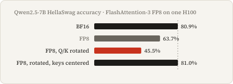

# temperament

I measure how FP8 attention changes multiple-choice answers.

<picture><source media="(prefers-color-scheme: dark)" srcset="docs/hero-dark.svg"></picture>

**Question:** Does rotating queries and keys before rounding hurt answer accuracy, and does centering keys first help?

**Result:** On Qwen2.5-7B HellaSwag, I measure **80.90% with BF16** → **63.70% with plain FP8 (`tile`, unrotated FA3)** → **45.50% with rotated FP8**. With keys centered, with or without rotation, no checkpoint loses **2 percentage points or more** versus BF16; the worst change is **−1.50pp** on Qwen2.5-1.5B MMLU. [All measurements](results/accuracy/summary.json).

**Rotation itself is task-dependent:** paired against unrotated FP8 on Qwen2.5-7B, it changes HellaSwag by **−18.20pp** (95% interval **[−20.90, −15.45]**) but MMLU by **+5.10pp** (**[+2.80, +7.35]**). After centering, its HellaSwag change is **+0.20pp [−0.25, +0.65]**. The direct contrasts below answer the intervention question; BF16-relative harm flags alone do not.

I used one H100, full-sequence per-head scales, and batch scoring rather than streaming generation.

Recompute the summaries and figure, and print the complete direct-contrast table from committed item records on CPU:

```sh
uv sync --locked --python 3.13
uv run python -m study.accuracy.report --additional-plan data/accuracy/qwen14-plan.json --additional-plan data/accuracy/smol17-plan.json
```

[Interactive mechanism and earlier emulated-head study](https://mottopanikeiku.github.io/temperament/).

## Answer accuracy

Eight checkpoints, four families, five attention variants, one H100: full **1,172-item ARC-Challenge test**, seeded **2,000-item HellaSwag validation** and subject-stratified **2,000-item MMLU test**, all zero-shot without chat templates. ARC/HellaSwag use character-normalized continuation likelihood; MMLU scores answer letters without normalization. [Item IDs, prompts and source revisions](data/accuracy/selection.json).

The table gives BF16 accuracy percentages and the count of flagged FP8-versus-BF16 comparisons, **not rotation-specific harm**. A flag requires a drop **≥2pp** and a paired bootstrap interval whose upper endpoint is below zero. There are 12 comparisons per checkpoint: three tasks × four nonbaseline variants. [Point estimates, all 95% intervals and raw-file hashes](results/accuracy/summary.json).

| Checkpoint | ARC | HellaSwag | MMLU | BF16-relative harm flags / 12 |
|---|---:|---:|---:|---:|
| Qwen2.5-0.5B-Instruct | 33.87 | 53.75 | 44.75 | 3 |
| Qwen2.5-1.5B-Instruct | 46.84 | 69.55 | 61.95 | 6 |
| Qwen2.5-3B-Instruct | 48.38 | 76.80 | 65.00 | 1 |
| Qwen2.5-7B-Instruct | 55.20 | 80.90 | 71.60 | 6 |
| Qwen2.5-14B-Instruct | 62.29 | 85.40 | 78.75 | 0 |
| Mistral-7B-v0.3 | 54.35 | 81.50 | 58.40 | 0 |
| OLMo-2-1124-7B | 57.17 | 81.25 | 59.50 | 0 |
| SmolLM2-1.7B | 47.44 | 72.95 | 48.60 | 0 |

The other three families are **base** checkpoints, so this is not a controlled ranking of family quality. Damage is not monotone with size: 7B Qwen is much worse than 14B here.


Using published [FlashAttention-3](https://arxiv.org/abs/2407.08608) and pinned [lm-evaluation-harness prompts](docs/PRIOR_WORK.md#fixed-item-multiple-choice-evaluation), my [data preparation](study/accuracy/data.py) fixes the items, [scorer](study/accuracy/worker.py) changes attention in every layer, and [reporter](study/accuracy/report.py) pairs answers with native GPU BF16. Projections, RoPE, norms and MLP remain native.

`tile` names unrotated FA3 with **full-sequence per-head scales**, not the earlier block-scaled emulator. `rotate` applies a shared signed Hadamard to Q/K; `smooth_k` subtracts the key mean; `rotate_smooth_k` does both. V is never rotated.

### Direct paired interventions

Measured accuracy changes in **percentage points [95% paired item bootstrap interval]**; positive means more correct answers. Every cell pairs the same `(task, item_id)` within one checkpoint. The four columns are `rotate − tile`, `smooth_k − tile`, `rotate_smooth_k − rotate`, and `rotate_smooth_k − smooth_k`: each changes only rotation or only centering, not the kernel or checkpoint.

<!-- interventions:start -->
| Checkpoint / task | Rotate − plain | Center − plain | Center rotated − rotated | Rotate centered − centered |
|---|---:|---:|---:|---:|
| Qwen2.5-0.5B-Instruct / ARC | −1.79 [−4.52, +0.94] | +0.94 [−0.77, +2.73] | +3.75 [+0.94, +6.57] | +1.02 [−0.85, +2.90] |
| Qwen2.5-0.5B-Instruct / HellaSwag | −9.15 [−11.20, −7.10] | +0.85 [−0.05, +1.75] | +9.85 [+7.85, +11.85] | −0.15 [−1.10, +0.80] |
| Qwen2.5-0.5B-Instruct / MMLU | −10.80 [−13.20, −8.40] | +1.55 [+0.00, +3.10] | +11.05 [+8.65, +13.45] | −1.30 [−2.95, +0.35] |
| Qwen2.5-1.5B-Instruct / ARC | +3.50 [+0.68, +6.31] | +8.96 [+6.40, +11.60] | +4.86 [+2.30, +7.42] | −0.60 [−1.88, +0.68] |
| Qwen2.5-1.5B-Instruct / HellaSwag | +0.85 [−1.20, +2.90] | +11.35 [+9.35, +13.40] | +10.60 [+8.75, +12.50] | +0.10 [−0.40, +0.60] |
| Qwen2.5-1.5B-Instruct / MMLU | +3.70 [+1.25, +6.15] | +19.55 [+17.15, +22.00] | +16.30 [+13.95, +18.60] | +0.45 [−0.60, +1.50] |
| Qwen2.5-3B-Instruct / ARC | +0.60 [−1.19, +2.39] | −0.68 [−2.56, +1.11] | +0.09 [−1.28, +1.45] | +1.37 [−0.09, +2.82] |
| Qwen2.5-3B-Instruct / HellaSwag | +1.30 [+0.35, +2.25] | +0.80 [−0.10, +1.70] | −0.30 [−1.00, +0.35] | +0.20 [−0.45, +0.85] |
| Qwen2.5-3B-Instruct / MMLU | +1.90 [+0.55, +3.25] | +2.35 [+1.00, +3.70] | +0.55 [−0.40, +1.50] | +0.10 [−0.80, +1.05] |
| Qwen2.5-7B-Instruct / ARC | −1.37 [−4.69, +1.96] | +13.91 [+10.84, +16.89] | +14.76 [+11.60, +17.92] | −0.51 [−1.96, +0.94] |
| Qwen2.5-7B-Instruct / HellaSwag | −18.20 [−20.90, −15.45] | +17.15 [+15.15, +19.15] | +35.55 [+33.05, +38.05] | +0.20 [−0.25, +0.65] |
| Qwen2.5-7B-Instruct / MMLU | +5.10 [+2.80, +7.35] | +14.35 [+12.20, +16.55] | +8.95 [+7.05, +10.85] | −0.30 [−1.05, +0.45] |
| Mistral-7B-v0.3 / ARC | +0.17 [−0.60, +0.94] | +0.00 [−0.85, +0.85] | −0.09 [−0.85, +0.68] | +0.09 [−0.85, +1.02] |
| Mistral-7B-v0.3 / HellaSwag | −0.15 [−0.65, +0.30] | −0.15 [−0.60, +0.35] | +0.35 [−0.05, +0.75] | +0.35 [−0.05, +0.75] |
| Mistral-7B-v0.3 / MMLU | −0.35 [−1.20, +0.50] | +0.30 [−0.60, +1.15] | +0.80 [+0.20, +1.40] | +0.15 [−0.60, +0.90] |
| OLMo-2-1124-7B / ARC | −0.60 [−1.45, +0.17] | −0.17 [−0.94, +0.60] | +0.34 [−0.34, +1.02] | −0.09 [−0.77, +0.60] |
| OLMo-2-1124-7B / HellaSwag | +0.00 [−0.30, +0.30] | −0.05 [−0.50, +0.40] | +0.00 [−0.30, +0.30] | +0.05 [−0.35, +0.45] |
| OLMo-2-1124-7B / MMLU | +0.20 [−0.55, +0.95] | −0.10 [−0.85, +0.65] | −0.55 [−1.30, +0.20] | −0.25 [−1.00, +0.50] |
| Qwen2.5-14B-Instruct / ARC | −0.26 [−1.54, +1.02] | −0.68 [−2.05, +0.68] | −0.09 [−1.11, +0.94] | +0.34 [−0.94, +1.62] |
| Qwen2.5-14B-Instruct / HellaSwag | +0.05 [−0.35, +0.45] | −0.05 [−0.50, +0.40] | +0.00 [−0.35, +0.35] | +0.10 [−0.30, +0.50] |
| Qwen2.5-14B-Instruct / MMLU | +0.50 [−0.15, +1.20] | +0.30 [−0.35, +0.95] | +0.00 [−0.55, +0.55] | +0.20 [−0.35, +0.75] |
| SmolLM2-1.7B / ARC | +0.85 [−0.34, +2.13] | +0.26 [−0.94, +1.45] | +0.00 [−1.11, +1.19] | +0.60 [−0.60, +1.79] |
| SmolLM2-1.7B / HellaSwag | +0.40 [−0.20, +1.00] | +0.30 [−0.40, +1.00] | −0.05 [−0.60, +0.50] | +0.05 [−0.55, +0.65] |
| SmolLM2-1.7B / MMLU | +1.70 [+0.40, +3.00] | +1.65 [+0.25, +3.05] | −0.70 [−1.85, +0.45] | −0.65 [−1.85, +0.55] |
<!-- interventions:end -->

These are exploratory contrasts added after seeing the scores, with 20,000 deterministic paired resamples per cell. Their intervals are itemwise, not simultaneous or corrected for multiple comparisons; they do not establish equivalence or a universal rotation effect. [Pairing, seeds and exact contrast definitions](docs/REPRODUCE.md#paired-analysis). Both help and harm are visible: even within one checkpoint, rotation need not move all tasks in the same direction.

## Why centering can help

A shared key vector adds the same offset to every visible score in a query row; exact softmax cancels it. Rotation can spread that vector across channels and coarsen the token-specific residual during rounding. Removing it preserves exact attention, not necessarily quantized attention. The results support a contributor, not one universal cause. [Derivation and earlier controls](docs/V2_PREDICTION.md).

The earlier real-kernel study measured a **12.56× batch exp-CE ratio** for rotated Qwen1.5B and **1.004×** after centering. It also showed that high predictor AUC can coexist with poor Sage threshold precision. These are separate numerical/loss experiments, not task-accuracy forecasts. [Earlier results](results/hardware/summary.json).

For kernel maintainers, a [small public CPU regression corpus](docs/REPRODUCE.md#public-numerical-regression-corpus) includes a rotation-harmed head, a helped head, matched constant-bias controls, FP64 references and exact FP8 Q/K packing bytes. These are emulator examples, not FA3/Sage output oracles or a replacement for the private hardware operands.

## Reproduce

Repeating model scoring requires **H100 80GB** for the native FA3 FP8 API. CPU-only cloud stages download/hash weights and tokenize before GPU allocation. The complete new-study compute bound is **$4.77 including the failed preparation and pilot**, not an invoice; downloaded checkpoint copies were removed afterward. [Cost accounting](results/accuracy/cost.json); [full stages, licenses and methods](docs/REPRODUCE.md#fixed-item-multiple-choice-accuracy).

## Limits and prior work

- Fixed samples and standard zero-shot prompts, not chat or task-general ability.
- Itemwise intervals, no multiple-comparison correction; absence of a flag is not equivalence.
- Full-sequence scales/means can see later tokens: batch scoring, not streaming generation.
- One GPU/kernel configuration; no latency or memory-saving benchmark, no new-model risk forecast.
- Qwen3B is noncommercial research/evaluation only; the other model checkpoints are Apache-2.0. No weights are redistributed.

Built on [FlashAttention-3](https://arxiv.org/abs/2407.08608), earlier [SageAttention](https://arxiv.org/abs/2410.02367) comparisons and [lm-evaluation-harness](https://github.com/EleutherAI/lm-evaluation-harness/tree/ad3f4d0cad1cfcdb815f1e795f7947e49ed9f2e9); upstream work is attributed, not presented as my kernel.

Written with AI coding assistance.
